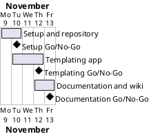

# Project Plan

## Metadata
| Key | Value |
| --- | --- |
| ID | PP-001 |
| CrossReference | [BC-001], [SA-001], [MIL-001], [MIL-002], [MIL-003] |
| Language | en |
| Domain | it |

## Version History
| Date | Status | Author | Reviewer | Change | Commit |
| --- | --- | --- | --- | --- | --- |
| 2026-11-09 | Deprecated | Jens Tirsvad Nielsen | S01 | Initial version | pending |
| 2026-11-09 | Accepted | Jens Tirsvad Nielsen | AI as stand-in for S01 | Accepted after [RC-003] (autonomous, not independent) | pending |

---

## Purpose

Schedule the three phases that deliver the Day 57 "Blog Capstone Project Part 1 - Templating" assignment inside the one-week window set by the Business Case [BC-001].

## Planning Assumptions

- Week 1 starts 2026-11-09; the plan ends by 2026-11-13, per the Business Case constraint (source: [BC-001] Constraints; the date is an assumption, the brief gives none).
- A phase is one to two days; one branch and one pull request per phase (source: the Product Owner's brief, "branch for pull request").
- S01 owns and approves every phase; the AI acts as stand-in reviewer in autonomous mode and the `RC-*` says so (SA-001 communication cadence: per run).

## Gateway Schedule

| Gateway | Document | Window | Decision date | Owner | Stories | Main deliverable | Milestone |
| --- | --- | --- | --- | --- | --- | --- | --- |
| Setup and repository | [MIL-001] | 2026-11-09 to 2026-11-10 | 2026-11-10 | S01 | none (technical tasks) | Project skeleton, environment instructions, described repository | not yet synced |
| Templating app | [MIL-002] | 2026-11-10 to 2026-11-12 | 2026-11-12 | S01 | none (technical tasks) | Flask app and offline pytest suite | not yet synced |
| Documentation and wiki | [MIL-003] | 2026-11-12 to 2026-11-13 | 2026-11-13 | S01 | none (technical tasks) | README and en/da/ms wiki with screenshots | not yet synced |



## Scope Coverage

| Business Case scope item | Gateway |
| --- | --- |
| `pyproject.toml`, `.gitignore`, `constants.py`, `Doxyfile`, folders | [MIL-001] |
| Repository description and topics | [MIL-001] |
| Flask application, templates, static assets | [MIL-002] |
| Tests with pytest, Doxygen comments in the source | [MIL-002] |
| README, wiki in en, da, ms, screenshots | [MIL-003] |

## Dependencies

```
MIL-001 → MIL-002 → MIL-003
```

A No-Go on a phase moves every later phase by the time needed to fix it; the end date is then moved only by S01, the Product Owner, instead of being cut silently.

## Plan Risks

| Risk | Impact | Mitigation |
| --- | --- | --- |
| Starter-file link expired or blog API offline (BC risks 1 and 2) | MIL-002 and the screenshots slip | Rebuild templates from the lecture description; keep a JSON fixture; record in Open Issues |
| Docker is not available on the host (BC risk 3) | Screenshots cannot be taken as `gui-testing.md` requires | Check Docker at the start of MIL-003; stop and report instead of using the host desktop |
| Translation effort for two languages (BC risk 4) | MIL-003 slips | English is written first and stays authoritative; translations follow page by page |

## Open Issues

- The one-week window is an assumption; S01 may set another date.
- "Python greater than 3.13" is read as 3.13 or newer.
- No user stories or use cases are modelled: the tasks are the implementation steps of a tutorial assignment and are plain tasks, not goals of a user. S01 can ask for use cases; this plan would then gain a story task before MIL-002.
- The n:Point API address is read from the starter files (task 1 of MIL-002); if it is not there, S01 supplies it.

---

[BC-001]: ./business-case.md
[SA-001]: ./stakeholder-analysis.md
[MIL-001]: ./milestones/mil-001-setup-and-repository.md
[MIL-002]: ./milestones/mil-002-templating-app.md
[MIL-003]: ./milestones/mil-003-documentation-and-wiki.md
[RC-003]: ./sqa/reviews/rc-003-project-plan.md
